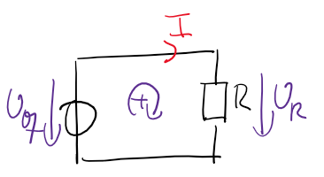
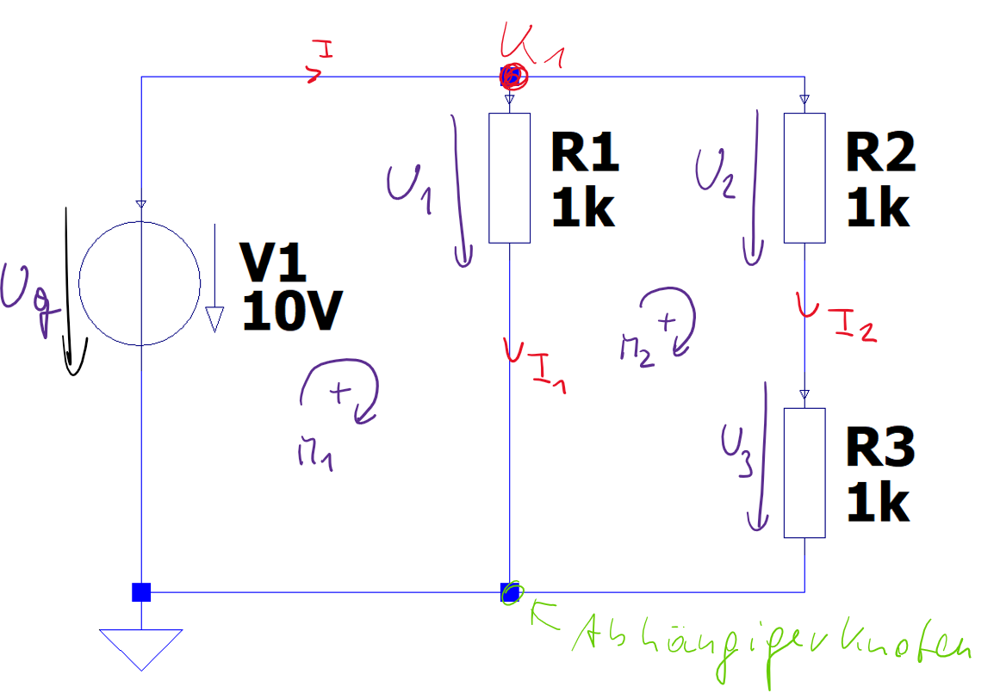
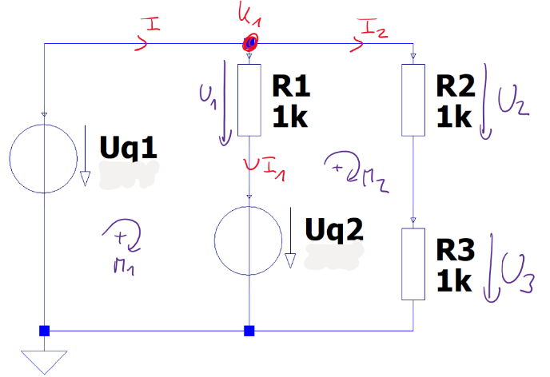
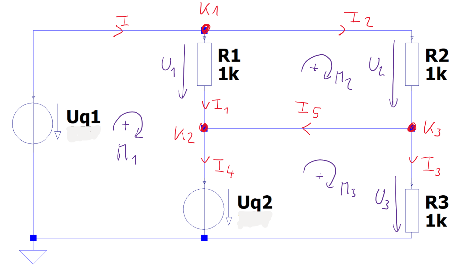
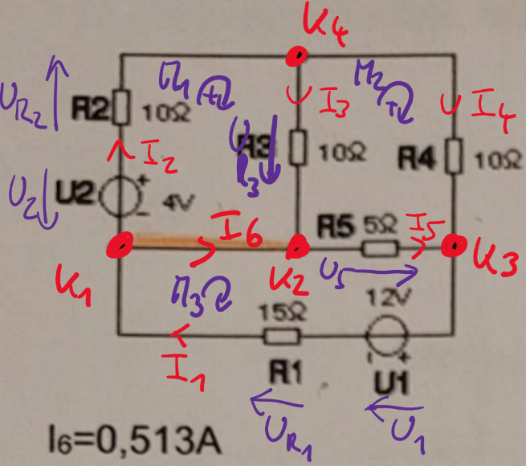

# Knoten- Spannungs- Analyse {#sec-KonoSpannungsanalyse}  

Die Knoten-Spannungsanalyse ist eine Methode zur Berechnung der unbekannten elektrischen Größen in einem Netzwerk von elektrischen oder elektronischen Komponenten.  
Unter Verwendung der Knotenregel, der Maschenregel und dem Ohmschen Gesetz werden Gleichungen aufgestellt, welche die Schaltung rechnerisch beschreiben. 
Es entsteht ein lineares Gleichungssystem, das gelöst werden kann.

Alternativ kann das lineare Gleichungssystem in Matrixform $A \cdot x = b$ geschrieben und mit Matrizen gelöst werden.

## Gleichungssysteme mit Matrizen

Dies ist besonders gut geeignet, wenn die Schaltung komplex ist und viele Unbekannte enthält und damit mittels Berechnungsprogrammen gelöst werden soll.

Weiterfuehrende Links:

1. Lineare Gleichungssysteme mit Matrizen in GeoGebra: [GeoGebra Matrix-Rechner](https://www.geogebra.org/m/mwbyyfpn)
1. Lineare Gleichungssysteme mit Python SymPy: [SymPy solve matrix equation](https://docs.sympy.org/latest/guides/solving/solve-matrix-equation.html)

Für ein lineares Gleichungssystem mit $n$ Unbekannten wird zuerst eine feste Reihenfolge der Unbekannten gewählt, zum Beispiel

$$
x = \begin{pmatrix}x_1\\x_2\\\vdots\\x_n\end{pmatrix}.
$$

Danach werden alle Gleichungen so umgeformt, dass links nur Terme mit Unbekannten stehen und rechts nur Zahlenwerte bzw. bekannte Größen. Dadurch entsteht die Matrixgleichung

$$
A \cdot x = b.
$$

Dabei gilt:

$$
A = \begin{pmatrix}
a_{11} & a_{12} & \cdots & a_{1n} \\
a_{21} & a_{22} & \cdots & a_{2n} \\
\vdots & \vdots & \ddots & \vdots \\
a_{n1} & a_{n2} & \cdots & a_{nn}
\end{pmatrix}, \qquad
b = \begin{pmatrix}b_1\\b_2\\\vdots\\b_n\end{pmatrix}.
$$

### Erweiterte Matrix

Zur praktischen Rechnung wird oft die erweiterte Matrix verwendet. Dabei werden die Koeffizientenmatrix $A$ und der rechte Vektor $b$ zu einer Matrix zusammengefasst:

$$
(A|b) =
\left(\begin{array}{cccc|c}
a_{11} & a_{12} & \cdots & a_{1n} & b_1 \\
a_{21} & a_{22} & \cdots & a_{2n} & b_2 \\
\vdots & \vdots & \ddots & \vdots & \vdots \\
a_{n1} & a_{n2} & \cdots & a_{nn} & b_n
\end{array}\right).
$$

Diese Schreibweise ist hilfreich, weil alle Umformungen in einem einzigen Objekt durchgeführt werden.

### Gauß-Elimination

Bei der Gauß-Elimination sind nur drei Zeilenumformungen erlaubt:

1. Zwei Zeilen vertauschen.
1. Eine Zeile mit einem von Null verschiedenen Faktor multiplizieren.
1. Ein Vielfaches einer Zeile zu einer anderen Zeile addieren.

Ziel ist die Zeilenstufenform. Danach werden die Unbekannten durch Rückwärtseinsetzen berechnet.

Wenn in einer Zeile links nur Nullen stehen, ergeben sich zwei wichtige Fälle:

1. $0 = c$ mit $c \neq 0$: keine Lösung (Widerspruch).
1. $0 = 0$: diese Zeile liefert keine neue Information (abhängige Gleichung).

#### Von der erweiterten Matrix zur Lösung

Nach der Umformung zur Zeilenstufenform liegt die erweiterte Matrix typischerweise in der Form

$$
\left(\begin{array}{cccc|c}
* & * & \cdots & * & * \\
0 & * & \cdots & * & * \\
\vdots & \vdots & \ddots & \vdots & \vdots \\
0 & 0 & \cdots & * & *
\end{array}\right)
$$

vor. Daraus entstehen die Lösungsschritte:

1. In der untersten Zeile steht nur noch eine Unbekannte. Diese wird zuerst direkt berechnet.
1. Der berechnete Wert wird in die Zeile darüber eingesetzt. Dadurch fällt dort eine Variable weg und die nächste Unbekannte kann berechnet werden.
1. Dieser Vorgang wird Zeile für Zeile nach oben wiederholt, bis alle Unbekannten bestimmt sind (Rückwärtseinsetzen).
1. Zum Schluss werden alle berechneten Werte in die ursprünglichen Gleichungen eingesetzt. Nur wenn alle Gleichungen erfüllt sind, ist die Lösung korrekt (Probe).

Wichtig: Die Probe wird mit den Ausgangsgleichungen durchgeführt, nicht mit bereits umgeformten Zwischenzeilen.

### Determinantenmethode (Cramersche Regel)

Für quadratische Systeme kann man die Lösbarkeit auch über die Determinante prüfen:

1. $\det(A) \neq 0$: genau eine Lösung.
1. $\det(A) = 0$: keine eindeutige Lösung (entweder keine oder unendlich viele).

Falls $\det(A) \neq 0$, kann jede Unbekannte mit der Cramerschen Regel berechnet werden:

$$
x_i = \frac{\det(A_i)}{\det(A)},
$$

wobei $A_i$ aus $A$ entsteht, indem die $i$-te Spalte durch $b$ ersetzt wird.

Die Determinantenmethode ist didaktisch sehr nützlich, für größere Systeme ist die Gauß-Elimination meist der praktischere Rechenweg.

### Rueckwaertseinsetzen

Nach der Gauß-Elimination liegt die letzte Zeile meist als Gleichung mit nur einer Unbekannten vor. Diese Unbekannte wird zuerst berechnet. Danach wird ihr Wert in die Zeile darüber eingesetzt, wodurch dort wieder nur eine neue Unbekannte übrig bleibt. So arbeitet man sich von unten nach oben, bis alle Unbekannten bestimmt sind.

### Probe durch Einsetzen

Alle berechneten Werte werden in die ursprünglichen Knoten-, Maschen- und Ohm-Gleichungen eingesetzt. Ist jede Gleichung erfüllt, ist die Lösung konsistent. Tritt in einer Gleichung ein Widerspruch auf, liegt ein Rechen- oder Umformungsfehler vor und die betroffenen Schritte müssen überprüft werden.

## Beispiel 1
In Grafik @fig-KSA1 ist ein Netzwerk aus Widerständen und Spannungsquellen dargestellt.  

{#fig-KSA1}

Vorgehensweise  
**1. Alle Ströme und Spannungen einzeichnen**  
**2. Unbekannte Größen definieren** 
```{python}
#| code-fold: true
#| echo: false

from sympy import *

# Variablen
R = MySymbol('R',description='Widerstand',unit='Ohm')
Uq = MySymbol('U_q',description='Quellspannung',unit='V')
UR = MySymbol('U_R',description='Spannungsabfall am Widerstand',unit='V')
I = MySymbol('I',description='Strom',unit='A')

QBookHelpers.print_description([R,Uq,UR,I])

```

**3. Knoten und Maschen einzeichnen**  
Siehe @fig-KSA1  
**4. Knoten- und Maschengleichungen aufstellen**  

```{python}
#| code-fold: true
#| echo: false

# Gleichungen
display(Markdown('Maschengleichungen'))
M1 = Eq(0, -Uq + UR)
display(M1)

display(Markdown('Knotengleichungen'))
display(Markdown('Es gibt keinen Knoten'))
```

**5. Ohmsche Gesetze für die Widerstände anschreiben**   

```{python}
#| code-fold: true  
#| echo: false


display(Markdown('Ohmsches Gesetz'))
O1 = Eq(UR, R*I)
display(O1)

```

**6. Überprüfen, ob es gleich viele Gleichungen wie Unbekannte gibt**  
Passt, es gibt 2 Gleichungen und 2 Unbekannte.  

**7. Gleichungssystem lösen**  
Das Gleichungssystem kann mit der Hand gelöst werden. Für komplexere Schaltungen ist es sinnvoll, ein Computerprogramm zu verwenden.    

Vorgehen mit Zettel und Stift:

1. Aus der Maschengleichung folgt direkt $U_R = U_q$.
1. Diese Beziehung wird in das Ohmsche Gesetz $U_R = R \cdot I$ eingesetzt.
1. Danach wird nach $I$ umgestellt: $I = \frac{U_q}{R}$.
1. Zum Schluss wird $U_R$ mit $U_R = U_q$ angegeben und die Lösung durch Einsetzen kontrolliert.

```{python}
#| code-fold: true
#| echo: false

# Gleichungssystem lösen
unknowns = [UR,I]
equations = [M1, O1]
sol = linsolve(equations,unknowns)
#display(sol)
for unk in unknowns:
    display(Eq(unk,sol.args[0][unknowns.index(unk)]))

```

### Lösung mittels Matrizen

Die Matrixrechnung kann ebenfalls händisch durchgeführt werden:

1. Unbekanntenvektor festlegen, z.B. $x = \begin{pmatrix}U_R \\ I\end{pmatrix}$.
1. Beide Gleichungen so umformen, dass alle Unbekannten links stehen.
1. Koeffizienten in die Matrix $A$ und rechte Seiten in den Vektor $b$ eintragen.
1. Das lineare System $A \cdot x = b$ mit Gauß-Verfahren lösen und die Ergebnisse rückprüfen.

Von $(A|b)$ zur Lösung in diesem Beispiel:

1. Die erste Zeile wird als Pivotzeile verwendet. Mit ihr wird der Eintrag darunter auf Null gebracht, damit die zweite Zeile nur noch eine Unbekannte enthält.
1. Aus dieser zweiten Zeile wird zuerst $I$ berechnet, weil dort kein weiterer unbekannter Term mehr übrig ist.
1. Der berechnete Strom $I$ wird in die erste Zeile eingesetzt. Dadurch erhält man direkt $U_R$.
1. Abschließend werden beide Werte in Maschen- und Ohm-Gleichung eingesetzt, um die Konsistenz der Lösung zu prüfen.

Vollständige Ausrechnung (händisch):

Zuerst in matrixgeeignete Normalform bringen (alle Unbekannten links, bekannte Größen rechts):

$$
\begin{aligned}
U_R + 0\,I &= U_q \\
U_R - R I &= 0
\end{aligned}
$$

mit Unbekanntenvektor $x = \begin{pmatrix}U_R \\ I\end{pmatrix}$ folgt

$$
A = \begin{pmatrix}1 & 0 \\ 1 & -R\end{pmatrix}, \quad
b = \begin{pmatrix}U_q \\ 0\end{pmatrix}, \quad
(A|b)=
\left(\begin{array}{cc|c}
1 & 0 & U_q \\
1 & -R & 0
\end{array}\right).
$$

Die Matrixschreibweise lautet damit explizit:

$$
\begin{pmatrix}1 & 0 \\ 1 & -R\end{pmatrix}
\cdot
\begin{pmatrix}U_R \\ I\end{pmatrix}
=
\begin{pmatrix}U_q \\ 0\end{pmatrix}.
$$


Zeilenumformung:

$$
Z_2 \leftarrow Z_2 - Z_1
\Rightarrow
\left(\begin{array}{cc|c}
1 & 0 & U_q \\
0 & -R & -U_q
\end{array}\right).
$$

Rückwärtseinsetzen:

$$
\begin{aligned}
-R I &= -U_q \Rightarrow I = \frac{U_q}{R},\\
U_R &= U_q.
\end{aligned}
$$

Probe:

$$
U_R - R I = U_q - R\cdot\frac{U_q}{R} = 0.
$$

<!--
```{python}
#| code-fold: true
#| echo: false

A, b = linear_eq_to_matrix(equations, unknowns)
x = Matrix(unknowns)
display(Markdown('Matrixgleichung in kompakter Form'))
display(Markdown('$$A \\cdot x = b$$'))
display(Markdown('$$' + latex(A) + ' \\cdot ' + latex(x) + ' = ' + latex(b) + '$$'))
solution, parameters = A.gauss_jordan_solve(b)

if parameters.rows > 0:
    display(Markdown('Freie Parameter'))
    display(parameters)

for unk, value in zip(unknowns, solution):
    display(Eq(unk, value))

```

-->

Für so eine einfache Schaltung würde man die Knoten-Spannungs-Analyse nicht verwenden. Die Methode lässt sich allerdings auf beliebig Komplexe Schaltungen anwenden.

## Beispiel 2

In Grafik @fig-KSA2 ist ein Netzwerk aus Widerständen und Spannungsquellen dargestellt.  

{#fig-KSA2}

Vorgehensweise  
**1. Alle Ströme und Spannungen einzeichnen**  
**2. Unbekannte Größen definieren** 
```{python}
#| code-fold: true
#| echo: false

from sympy import *

# Variablen
R1 = MySymbol('R1',description='Widerstand 1',unit=u.ohm,value=1000)
R2 = MySymbol('R2',description='Widerstand 2',unit=u.ohm,value=1000)
R3 = MySymbol('R3',description='Widerstand 3',unit=u.ohm,value=1000)
Uq = MySymbol('U_q',description='Quellspannung',unit=u.V,value=10)
U1 = MySymbol('U1',description='Spannungsabfall an R1',unit=u.V)
U2 = MySymbol('U2',description='Spannungsabfall an R2',unit=u.V)
U3 = MySymbol('U3',description='Spannungsabfall an R3',unit=u.V)
I1 = MySymbol('I1',description='Strom durch R1',unit=u.A)
I2 = MySymbol('I2',description='Strom durch R2',unit=u.A)
I = MySymbol('I',description='Gesamtstrom',unit=u.A)

QBookHelpers.print_description([R1,R2,R3,Uq,U1,U2,U3,I1,I2,I])

```

**3. Knoten und Maschen einzeichnen**  
Siehe @fig-KSA2  
**4. Knoten- und Maschengleichungen aufstellen**  

```{python}
#| code-fold: true
#| echo: false

# Gleichungen
display(Markdown('Maschengleichungen'))
M1 = Eq(0, -Uq + U1)
M2 = Eq(0, -U1 + U2 + U3)
QBookHelpers.print_equation(M1,label='eq-M1')
QBookHelpers.print_equation(M2,label='eq-M2')

display(Markdown('Knotengleichungen'))
K1 = Eq(0, I - I1 - I2)
QBookHelpers.print_equation(K1,label='eq-K1')

```

**5. Ohmsche Gesetze für die Widerstände anschreiben**   

```{python}
#| code-fold: true  
#| echo: false


display(Markdown('Ohmsches Gesetz'))
O1 = Eq(U1, R1*I1)
O2 = Eq(U2, R2*I2)
O3 = Eq(U3, R3*I2)
QBookHelpers.print_equation(O1,label='eq-O1')
QBookHelpers.print_equation(O2,label='eq-O2')
QBookHelpers.print_equation(O3, label='eq-O3')


```

**6. Überprüfen ob es gleich viele Gleichungen wie Unbekannte gibt**  
Passt, es gibt 6 Gleichungen und 6 Unbekannte.  

**7. Gleichungssystem lösen**  
Das Gleichungssystem kann mit der Hand gelöst werden. Für komplexere Schaltungen ist es sinnvoll, ein Computerprogramm zu verwenden.    

Rechenweg in kurzen Schritten:

1. Zuerst die Maschengleichungen verwenden, um die Spannungen $U_1, U_2, U_3$ zu verknüpfen.
1. Mit den Ohmschen Gesetzen die Spannungen durch Ströme ausdrücken.
1. Die Knotengleichung einsetzen und schrittweise nur noch eine Unbekannte übrig lassen.
1. Danach rückwärts einsetzen, bis alle Spannungen und Ströme bestimmt sind.

```{python}
#| code-fold: true
#| echo: false

# Gleichungssystem lösen
unknowns = [U1,U2,U3,I1,I2,I]
equations = [M1,M2,K1,O1,O2,O3]
sol = linsolve(equations,unknowns)
#display(sol)
for unk in unknowns:
    eq = Eq(unk,sol.args[0][unknowns.index(unk)])
    QBookHelpers.print_equation(eq,label='eq-' + unk.name)
    QBookHelpers.calculate_num_value(eq)
    QBookHelpers.print_values([unk])


```

### Lösung mittels Matrizen

Für die Matrixdarstellung wird das System wieder in kleine Arbeitsschritte zerlegt:

1. Alle sechs Gleichungen in lineare Form bringen.
1. Unbekannte in einer festen Reihenfolge anordnen, z.B. $(U_1, U_2, U_3, I_1, I_2, I)$.
1. Daraus die Koeffizientenmatrix und den rechten Vektor aufstellen.
1. Mit dem Gauß-Verfahren Zeile für Zeile eliminieren und danach rückwärts einsetzen.

Von $(A|b)$ zur Lösung in diesem Beispiel:

1. Die Unbekanntenreihenfolge bleibt fix. Dann wird spaltenweise pivotiert, sodass unter jedem Pivot nur Nullen stehen.
1. Nach der Elimination liegt eine Stufenform vor. Die unterste Zeile enthält dann nur noch eine neue Unbekannte.
1. Diese Unbekannte wird berechnet und sofort in die darüberliegenden Zeilen eingesetzt. So wird die Zahl der Unbekannten pro Zeile Schritt für Schritt reduziert.
1. Dieser Prozess wird bis zur ersten Zeile fortgesetzt, bis alle sechs Größen berechnet sind.
1. Zum Schluss folgt die Probe in Knoten-, Maschen- und Ohm-Gleichungen. Dabei müssen alle linken und rechten Seiten übereinstimmen.

Vollständige Ausrechnung (händisch, symbolisch):

Ziel: Die sechs Unbekannten $U_1, U_2, U_3, I_1, I_2, I$ nacheinander so bestimmen, dass jede neue Gleichung möglichst nur noch eine neue Unbekannte enthält.

Welche Gleichungen werden in die Matrix gebracht?

Ausgangspunkt ist das volle Gleichungssystem aus Beispiel 2:

$$
\begin{aligned}
M1:&\ -U_q + U_1 = 0,\\
M2:&\ -U_1 + U_2 + U_3 = 0,\\
K1:&\ I - I_1 - I_2 = 0,\\
O1:&\ U_1 - R_1 I_1 = 0,\\
O2:&\ U_2 - R_2 I_2 = 0,\\
O3:&\ U_3 - R_3 I_2 = 0.
\end{aligned}
$$

Fuer die handschriftliche Matrixrechnung wird daraus ein aequivalentes reduziertes Strom-System gebildet:

1. Aus $M1$ und $O1$: $U_1 = U_q$ und damit $R_1 I_1 = U_q$.
1. Aus $M2$, $O2$, $O3$ und $U_1 = U_q$: $(R_2+R_3)I_2 = U_q$.
1. Aus $K1$: $I - I_1 - I_2 = 0$.

Explizite Gauß-Zeilenumformungen (auf dem reduzierten Strom-System):

Zuerst in matrixgeeignete Normalform bringen (alle Unbekannten links, bekannte Groessen rechts):

$$
R_1 I_1 = U_q,
\qquad
\left(R_2 + R_3\right) I_2 = U_q,
\qquad
I - I_1 - I_2 = 0.
$$

Mit Unbekanntenvektor $\begin{pmatrix}I_1 \\ I_2 \\ I\end{pmatrix}$ ergibt sich die erweiterte Matrix

$$
\left(\begin{array}{ccc|c}
R_1 & 0 & 0 & U_q \\
0 & R_2+R_3 & 0 & U_q \\
-1 & -1 & 1 & 0
\end{array}\right).
$$

Die Matrixschreibweise lautet damit explizit:

$$
\begin{pmatrix}
R_1 & 0 & 0 \\
0 & R_2+R_3 & 0 \\
-1 & -1 & 1
\end{pmatrix}
\cdot
\begin{pmatrix}I_1 \\ I_2 \\ I\end{pmatrix}
=
\begin{pmatrix}U_q \\ U_q \\ 0\end{pmatrix}.
$$

Zeilenumformungen:

$$
Z_3 \leftarrow Z_3 + \frac{1}{R_1} Z_1
\Rightarrow
\left(\begin{array}{ccc|c}
R_1 & 0 & 0 & U_q \\
0 & R_2+R_3 & 0 & U_q \\
0 & -1 & 1 & \frac{U_q}{R_1}
\end{array}\right)
$$

$$
Z_3 \leftarrow Z_3 + \frac{1}{R_2+R_3} Z_2
\Rightarrow
\left(\begin{array}{ccc|c}
R_1 & 0 & 0 & U_q \\
0 & R_2+R_3 & 0 & U_q \\
0 & 0 & 1 & \frac{U_q}{R_1} + \frac{U_q}{R_2+R_3}
\end{array}\right).
$$

Rückwärtseinsetzen liefert damit direkt:

$$
I = \frac{U_q}{R_1} + \frac{U_q}{R_2+R_3},
\qquad
I_2 = \frac{U_q}{R_2+R_3},
\qquad
I_1 = \frac{U_q}{R_1}.
$$

Aus den Gleichungen folgen direkt

$$
U_1 = U_q, \qquad U_2 + U_3 = U_1 = U_q.
$$

Mit den Ohmschen Gesetzen

$$
U_1 = R_1 I_1, \quad U_2 = R_2 I_2, \quad U_3 = R_3 I_2
$$

erhaelt man:

$$
I_1 = \frac{U_1}{R_1} = \frac{U_q}{R_1}.
$$

Außerdem gilt

$$
U_2 + U_3 = (R_2+R_3)I_2 = U_q
\Rightarrow
I_2 = \frac{U_q}{R_2+R_3}.
$$

Damit:

$$
U_2 = R_2 I_2 = \frac{R_2}{R_2+R_3}U_q,
\qquad
U_3 = R_3 I_2 = \frac{R_3}{R_2+R_3}U_q.
$$

Aus der Knotengleichung:

$$
I = I_1 + I_2 = \frac{U_q}{R_1} + \frac{U_q}{R_2+R_3}.
$$

Erst zum Schluss Werte einsetzen (hier: $R_1=R_2=R_3=1000\,\Omega$, $U_q=10\,\mathrm{V}$):

$$
I_1 = 0.01\,\mathrm{A},\quad
I_2 = 0.005\,\mathrm{A},\quad
I = 0.015\,\mathrm{A},\quad
U_1 = 10\,\mathrm{V},\quad
U_2 = 5\,\mathrm{V},\quad
U_3 = 5\,\mathrm{V}.
$$

Lösung (mit eingesetzten Werten):

$$
\begin{aligned}
U_1 &= 10\,\mathrm{V}, & U_2 &= 5\,\mathrm{V}, & U_3 &= 5\,\mathrm{V},\\
I_1 &= 0.01\,\mathrm{A}, & I_2 &= 0.005\,\mathrm{A}, & I &= 0.015\,\mathrm{A}.
\end{aligned}
$$

Probe:

Die Probe ist wichtig, weil bei mehreren Umformungen kleine Vorzeichenfehler häufig sind. Erst wenn sowohl Maschen- als auch Knotengleichungen erfüllt sind, ist die Lösung verlässlich.


$$
\begin{aligned}
M2:&\ -U_1 + U_2 + U_3 = -10 + 5 + 5 = 0,\\
K1:&\ I - I_1 - I_2 = 0.015 - 0.01 - 0.005 = 0.
\end{aligned}
$$

<!--
```{python}
#| code-fold: true
#| echo: false

A, b = linear_eq_to_matrix(equations, unknowns)
x = Matrix(unknowns)
display(Markdown('Matrixgleichung in kompakter Form'))
display(Markdown('$$A \\cdot x = b$$'))
display(Markdown('$$' + latex(A) + ' \\cdot ' + latex(x) + ' = ' + latex(b) + '$$'))
solution, parameters = A.gauss_jordan_solve(b)

if parameters.rows > 0:
    display(Markdown('Freie Parameter'))
    display(parameters)

for unk, value in zip(unknowns, solution):
    display(Eq(unk, value))

```

-->

## Beispiel 3

In Grafik @fig-KSA3 ist ein Netzwerk aus Widerständen und Spannungsquellen dargestellt.  

{#fig-KSA3}


### Alle Ströme und Spannungen einzeichnen  

### Bekannte Größen  

```{python}
#| code-fold: true
#| echo: false

from sympy import *

# Variablen
R1 = MySymbol('R1',description='Widerstand 1',unit=u.ohm,value=1000)
R2 = MySymbol('R2',description='Widerstand 2',unit=u.ohm,value=1000)
R3 = MySymbol('R3',description='Widerstand 3',unit=u.ohm,value=1000)
Uq1 = MySymbol('U_q1',description='Quellspannung',unit=u.V,value=10)
Uq2 = MySymbol('U_q2',description='Quellspannung',unit=u.V,value=1)
U1 = MySymbol('U1',description='Spannungsabfall an R1',unit=u.V)
U2 = MySymbol('U2',description='Spannungsabfall an R2',unit=u.V)
U3 = MySymbol('U3',description='Spannungsabfall an R3',unit=u.V)
I1 = MySymbol('I1',description='Strom durch R1',unit=u.A)
I2 = MySymbol('I2',description='Strom durch R2',unit=u.A)
I = MySymbol('I',description='Gesamtstrom',unit=u.A)

#QBookHelpers.print_description([R1,R2,R3,Uq1,Uq2])
QBookHelpers.print_values([R1,R2,R3,Uq1,Uq2])

```


### Unbekannte Größen definieren 

```{python}
#| code-fold: true
#| echo: false
#| 
QBookHelpers.print_description([U1,U2,U3,I1,I2,I])
```  

### Knoten und Maschen einzeichnen  
Siehe @fig-KSA3

### Knoten- und Maschengleichungen aufstellen  

```{python}
#| code-fold: true
#| echo: false

# Gleichungen
display(Markdown('Maschengleichungen'))
M1 = Eq(0, -Uq1 + U1 + Uq2)
M2 = Eq(0, -U1 -Uq2 + U2 + U3)
QBookHelpers.print_equation(M1,label='eq-M1')
QBookHelpers.print_equation(M2,label='eq-M2')

display(Markdown('Knotengleichungen'))
K1 = Eq(0, I - I1 - I2)
QBookHelpers.print_equation(K1,label='eq-K1')

```

### Ohmsche Gesetze für die Widerstände anschreiben   

```{python}
#| code-fold: true  
#| echo: false


display(Markdown('Ohmsches Gesetz'))
O1 = Eq(U1, R1*I1)
O2 = Eq(U2, R2*I2)
O3 = Eq(U3, R3*I2)
QBookHelpers.print_equation(O1,label='eq-O1')
QBookHelpers.print_equation(O2,label='eq-O2')
QBookHelpers.print_equation(O3, label='eq-O3')


```

### Überprüfen ob es gleich viele Gleichungen wie Unbekannte gibt  
Passt, es gibt 6 Gleichungen und 6 Unbekannte.  

### Gleichungssystem lösen  
Das Gleichungssystem kann mit der Hand gelöst werden. Für komplexere Schaltungen ist es sinnvoll, ein Computerprogramm zu verwenden.    

Hier ist der Lösungsweg besonders übersichtlich:

1. Zuerst werden die zwei Maschengleichungen, die Knotengleichung und die drei Ohmschen Gesetze gesammelt.
1. Dann werden die sechs Unbekannten festgelegt.
1. Eine Gleichung nach der anderen umstellen und die Ergebnisse direkt in die übrigen Gleichungen einsetzen.
1. Zum Schluss alle gesuchten Größen berechnen und jede Gleichung als Probe prüfen.

```{python}
#| code-fold: true
#| echo: false

# Gleichungssystem lösen
unknowns = [U1,U2,U3,I1,I2,I]
equations = [M1,M2,K1,O1,O2,O3]
sol = linsolve(equations,unknowns)
#display(sol)
for unk in unknowns:
    eq = Eq(unk,sol.args[0][unknowns.index(unk)])
    QBookHelpers.print_equation(eq,label='eq-' + unk.name)
    QBookHelpers.calculate_num_value(eq)
    QBookHelpers.print_values([unk])


```

### Lösung mittels Matrizen

Vollstaendige Ausrechnung (haendisch, symbolisch):

Welche Gleichungen werden in die Matrix gebracht?

Ausgangspunkt ist das volle Gleichungssystem aus Beispiel 3:

$$
\begin{aligned}
M1:&\ -U_{q1} + U_1 + U_{q2} = 0,\\
M2:&\ -U_1 - U_{q2} + U_2 + U_3 = 0,\\
K1:&\ I - I_1 - I_2 = 0,\\
O1:&\ U_1 - R_1 I_1 = 0,\\
O2:&\ U_2 - R_2 I_2 = 0,\\
O3:&\ U_3 - R_3 I_2 = 0.
\end{aligned}
$$

Fuer die handschriftliche Matrixrechnung wird wieder ein aequivalentes reduziertes Strom-System verwendet:

$$
\begin{aligned}
R_1 I_1 &= U_{q1}-U_{q2},\\
\left(R_2+R_3\right)I_2 &= U_{q1}-U_{q2},\\
I-I_1-I_2 &= 0.
\end{aligned}
$$

Mit Unbekanntenvektor $\begin{pmatrix}I_1 \\ I_2 \\ I\end{pmatrix}$ ergibt sich:

$$
\begin{pmatrix}
R_1 & 0 & 0 \\
0 & R_2+R_3 & 0 \\
-1 & -1 & 1
\end{pmatrix}
\cdot
\begin{pmatrix}I_1 \\ I_2 \\ I\end{pmatrix}
=
\begin{pmatrix}U_{q1}-U_{q2} \\ U_{q1}-U_{q2} \\ 0\end{pmatrix}.
$$

Erst zum Schluss Werte einsetzen und die Probe in den Ausgangsgleichungen durchfuehren.

```{python}
#| code-fold: true
#| echo: false

A, b = linear_eq_to_matrix(equations, unknowns)
x = Matrix(unknowns)
display(Markdown('Matrixgleichung in kompakter Form'))
display(Markdown('$$A \\cdot x = b$$'))
display(Markdown('$$' + latex(A) + ' \\cdot ' + latex(x) + ' = ' + latex(b) + '$$'))
solution, parameters = A.gauss_jordan_solve(b)

if parameters.rows > 0:
    display(Markdown('Freie Parameter'))
    display(parameters)

for unk, value in zip(unknowns, solution):
    display(Eq(unk, value))

```


## Beispiel 4

In Grafik @fig-KSA4 ist ein Netzwerk aus Widerständen und Spannungsquellen dargestellt.  

{#fig-KSA4}

Vorgehensweise  
**1. Alle Ströme und Spannungen einzeichnen**  
**2. Unbekannte Größen definieren** 
```{python}
#| code-fold: true
#| echo: false

from sympy import *

# Variablen
R1 = MySymbol('R1',description='Widerstand 1',unit=u.ohm,value=1000)
R2 = MySymbol('R2',description='Widerstand 2',unit=u.ohm,value=1000)
R3 = MySymbol('R3',description='Widerstand 3',unit=u.ohm,value=1000)
Uq1 = MySymbol('U_q1',description='Quellspannung',unit=u.V,value=10)
Uq2 = MySymbol('U_q2',description='Quellspannung',unit=u.V,value=1)
U1 = MySymbol('U1',description='Spannungsabfall an R1',unit=u.V)
U2 = MySymbol('U2',description='Spannungsabfall an R2',unit=u.V)
U3 = MySymbol('U3',description='Spannungsabfall an R3',unit=u.V)
I1 = MySymbol('I1',description='Strom durch R1',unit=u.A)
I2 = MySymbol('I2',description='Strom durch R2',unit=u.A)
I3 = MySymbol('I3',description='Strom durch R3',unit=u.A)
I4 = MySymbol('I4',description='Strom durch Quelle $U_{q2}$',unit=u.A)
I5 = MySymbol('I5',description='Querstrom',unit=u.A)
I = MySymbol('I',description='Gesamtstrom',unit=u.A)

display(Markdown('Bekannte Größen'))
knowns = [R1,R2,R3,Uq1,Uq2]
QBookHelpers.print_description(knowns)
QBookHelpers.print_values(knowns)

display(Markdown('Unbekannte Größen'))
unknowns = [U1,U2,U3,I1,I2,I3,I4,I5,I]
QBookHelpers.print_description(unknowns)

```

**3. Knoten und Maschen einzeichnen**  
Siehe @fig-KSA4

**4. Knoten- und Maschengleichungen aufstellen**  

```{python}
#| code-fold: true
#| echo: false

# Gleichungen
display(Markdown('Maschengleichungen'))
M1 = Eq(0, -Uq1 + U1 + Uq2)
M2 = Eq(0, -U1 + U2)
M3 = Eq(0, -Uq2 + U3)
QBookHelpers.print_equation(M1,label='eq-M1')
QBookHelpers.print_equation(M2,label='eq-M2')
QBookHelpers.print_equation(M3,label='eq-M3')

display(Markdown('Knotengleichungen'))
K1 = Eq(0, I - I1 - I2)
K2 = Eq(0, I1 - I4 + I5)
K3 = Eq(0, I2 - I5 - I3)
QBookHelpers.print_equation(K1,label='eq-K1')
QBookHelpers.print_equation(K2,label='eq-K2')
QBookHelpers.print_equation(K3,label='eq-K2')

```

**5. Ohmsche Gesetze für die Widerstände anschreiben**   

```{python}
#| code-fold: true  
#| echo: false


display(Markdown('Ohmsches Gesetz'))
O1 = Eq(U1, R1*I1)
O2 = Eq(U2, R2*I2)
O3 = Eq(U3, R3*I3)
QBookHelpers.print_equation(O1,label='eq-O1')
QBookHelpers.print_equation(O2,label='eq-O2')
QBookHelpers.print_equation(O3, label='eq-O3')


```

**6. Überprüfen ob es gleich viele Gleichungen wie Unbekannte gibt**  
Passt, es gibt 9 Gleichungen und 9 Unbekannte. 

**7. Gleichungssystem lösen**

Wenn mehr Gleichungen als Unbekannte vorhanden sind, hilft dieses Schema:

1. Zuerst prüfen, ob das System widerspruchsfrei ist.
1. Danach unabhängige Gleichungen auswählen und abhängige Gleichungen als Kontrolle behandeln.
1. Das reduzierte System von Hand lösen (Einsetzen oder Gauß-Verfahren).
1. Die erhaltene Lösung in alle ursprünglichen Gleichungen einsetzen und prüfen.
Das Gleichungssystem kann mit der Hand gelöst werden. Für komplexere Schaltungen ist es sinnvoll, ein Computerprogramm zu verwenden.    

```{python}
#| code-fold: true
#| echo: false

# Gleichungssystem lösen
equations = [M1,M2,M3,K1,K2,K3,O1,O2,O3]
sol = linsolve(equations,unknowns)
#display(sol)
if sol == EmptySet:
    display(Markdown('Das Gleichungssystem hat keine Lösung'))
else:
    for unk in unknowns:
        eq = Eq(unk,sol.args[0][unknowns.index(unk)])
        QBookHelpers.print_equation(eq,label='eq-' + unk.name)
        QBookHelpers.calculate_num_value(eq)
        QBookHelpers.print_values([unk])

```

### Lösung mittels Matrizen

Vollstaendige Ausrechnung (haendisch, symbolisch):

Welche Gleichungen werden in die Matrix gebracht?

In Beispiel 4 wird das volle, bereits aufgestellte Gleichungssystem verwendet:

$$
\begin{aligned}
M1:&\ -U_{q1}+U_1+U_{q2}=0,\\
M2:&\ -U_1+U_2=0,\\
M3:&\ -U_{q2}+U_3=0,\\
K1:&\ I-I_1-I_2=0,\\
K2:&\ I_1-I_4+I_5=0,\\
K3:&\ I_2-I_5-I_3=0,\\
O1:&\ U_1-R_1 I_1=0,\\
O2:&\ U_2-R_2 I_2=0,\\
O3:&\ U_3-R_3 I_3=0.
\end{aligned}
$$

Unbekanntenreihenfolge (wie im Code):

$$
x = \begin{pmatrix}U_1\\U_2\\U_3\\I_1\\I_2\\I_3\\I_4\\I_5\\I\end{pmatrix}.
$$

Damit wird direkt die Matrixgleichung $A\cdot x=b$ gebildet und mit Gauß geloest. Numerische Werte werden erst nach der symbolischen Loesung eingesetzt.

```{python}
#| code-fold: true
#| echo: false

A, b = linear_eq_to_matrix(equations, unknowns)
x = Matrix(unknowns)
display(Markdown('Matrixgleichung in kompakter Form'))
display(Markdown('$$A \\cdot x = b$$'))
display(Markdown('$$' + latex(A) + ' \\cdot ' + latex(x) + ' = ' + latex(b) + '$$'))
solution, parameters = A.gauss_jordan_solve(b)

if parameters.rows > 0:
    display(Markdown('Freie Parameter'))
    display(parameters)

for unk, value in zip(unknowns, solution):
    display(Eq(unk, value))

```


## Beispiel 5

In Grafik @fig-KSA5 ist ein Netzwerk aus Widerständen und Spannungsquellen dargestellt.  

{#fig-KSA5}

Vorgehensweise  
**1. Alle Ströme und Spannungen einzeichnen**  
**2. Unbekannte Größen definieren** 
```{python}
#| code-fold: true

from sympy import *

# Variablen
R1 = MySymbol('R1',description='Widerstand 1',unit=u.ohm,value=15)
R2 = MySymbol('R2',description='Widerstand 2',unit=u.ohm,value=10)
R3 = MySymbol('R3',description='Widerstand 3',unit=u.ohm,value=10)
R4 = MySymbol('R4',description='Widerstand 3',unit=u.ohm,value=10)
R5 = MySymbol('R5',description='Widerstand 3',unit=u.ohm,value=5)
U1 = MySymbol('U_1',description='Quellspannung',unit=u.V,value=12)
U2 = MySymbol('U_2',description='Quellspannung',unit=u.V,value=4)
UR1 = MySymbol('U_R1',description='Spannungsabfall an R1',unit=u.V)
UR2 = MySymbol('U_R2',description='Spannungsabfall an R2',unit=u.V)
UR3 = MySymbol('U_R3',description='Spannungsabfall an R3',unit=u.V)
UR4 = MySymbol('U_R4',description='Spannungsabfall an R4',unit=u.V)
UR5 = MySymbol('U_R5',description='Spannungsabfall an R5',unit=u.V)
I1 = MySymbol('I1',description='Strom durch R1',unit=u.A)
I2 = MySymbol('I2',description='Strom durch R2',unit=u.A)
I3 = MySymbol('I3',description='Strom durch R3',unit=u.A)
I4 = MySymbol('I4',description='Strom durch R4',unit=u.A)
I5 = MySymbol('I5',description='Strom durch R5',unit=u.A)
I6 = MySymbol('I6',description='Querstrom',unit=u.A)

display(Markdown('**Bekannte Größen**'))
knowns = [R1,R2,R3,R4,R5,U1,U2]
QBookHelpers.print_description(knowns)
QBookHelpers.print_values(knowns)
display(Markdown('Anzahl der bekannten Größen:'))
display(len(knowns))

display(Markdown('**Unbekannte Größen**'))
unknowns = [UR1,UR2,UR3,UR4,UR5,I1,I2,I3,I4,I5,I6]
QBookHelpers.print_description(unknowns)
display(Markdown('Anzahl der unbekannten Größen:'))
display(len(unknowns))

```

**3. Knoten und Maschen einzeichnen**  
Siehe @fig-KSA5

**4. Knoten- und Maschengleichungen aufstellen**  

```{python}
#| code-fold: true

# Gleichungen
display(Markdown('Maschengleichungen'))
M1 = Eq(0, U1+UR1+UR5)
M2 = Eq(0, -UR5+UR4-UR3)
M3 = Eq(0, +UR3-U2+UR2)
QBookHelpers.print_equation(M1,label='eq-M1')
QBookHelpers.print_equation(M2,label='eq-M2')
QBookHelpers.print_equation(M3,label='eq-M3')

display(Markdown('Knotengleichungen'))
K1 = Eq(0, I1-I2-I6)
K2 = Eq(0, I6+I3-I5)
K3 = Eq(0, I4+I5-I1)
K4 = Eq(0, I2-I4-I3)

QBookHelpers.print_equation(K1,label='eq-K1')
QBookHelpers.print_equation(K2,label='eq-K2')
QBookHelpers.print_equation(K3,label='eq-K3')
QBookHelpers.print_equation(K4,label='eq-K4')


```

**5. Ohmsche Gesetze für die Widerstände anschreiben**   

```{python}
#| code-fold: true  


display(Markdown('Ohmsches Gesetz'))
O1 = Eq(UR1, R1*I1)
O2 = Eq(UR2, R2*I2)
O3 = Eq(UR3, R3*I3)
O4 = Eq(UR4, R4*I4)
O5 = Eq(UR5, R5*I5)
QBookHelpers.print_equation(O1,label='eq-O1')
QBookHelpers.print_equation(O2,label='eq-O2')
QBookHelpers.print_equation(O3, label='eq-O3')
QBookHelpers.print_equation(O4, label='eq-O4')
QBookHelpers.print_equation(O5, label='eq-O5')

equations = [M1,M2,M3,K1,K2,K3,K4,O1,O2,O3,O4,O5]
display(Markdown('Anzahl der Gleichungen:'))
display(len(equations))

```

**6. Überprüfen ob es gleich viele Gleichungen wie Unbekannte gibt**  

```{python}	
#| code-fold: true

display(Markdown('Anzahl der Gleichungen:'))
display(len(equations))
display(Markdown('Anzahl der Unbekannten:'))
display(len(unknowns))

if len(equations) > len(unknowns):
    display(Markdown('Das Gleichungssystem ist überbestimmt. Es gibt mehr Gleichungen als Unbekannte. Das bedeutet, dass einzelne Gleichungen abhängig sein können. Eine abhängige Gleichung kann aus den anderen abgeleitet werden. Wird sie entfernt, kann das reduzierte Gleichungssystem gelöst werden.'))
elif len(equations) < len(unknowns):
    display(Markdown('Das Gleichungssystem ist unterbestimmt. Es gibt mehr Unbekannte als Gleichungen. Das Gleichungssystem kann nicht gelöst werden.'))
elif len(equations) == len(unknowns):
    display(Markdown('Das Gleichungssystem hat gleich viele Gleichungen wie Unbekannte. Es kann gelöst werden, sofern es nicht widersprüchlich ist'))
else:
    display(Markdown('Fehler'))

```

**7. Gleichungssystem lösen**    

Rechenweg mit Zettel und Stift:

1. Zuerst ein unabhängiges Teilsystem auswählen (gleich viele Gleichungen wie Unbekannte).
1. Dieses Teilsystem sauber lösen, z.B. durch Einsetzen oder Gauß-Verfahren.
1. Danach alle berechneten Größen in die übrigen Gleichungen einsetzen.
1. Stimmen alle Restgleichungen, ist die Lösung des gesamten Netzwerks konsistent.

```{python}
#| code-fold: true


# Gleichungssystem lösen
sol = linsolve(equations,unknowns)
#display(sol)
if sol == EmptySet:
    display(Markdown('Das Gleichungssystem hat keine Lösung.'))
else:
    for unk in unknowns:
        eq = Eq(unk,sol.args[0][unknowns.index(unk)])
        QBookHelpers.print_equation(eq,label='eq-' + unk.name)
        QBookHelpers.calculate_num_value(eq)
        QBookHelpers.print_values([unk])

```

### Lösung mittels Matrizen

Vollstaendige Ausrechnung (haendisch, symbolisch):

Welche Gleichungen werden in die Matrix gebracht?

In Beispiel 5 werden alle aufgestellten Maschen-, Knoten- und Ohm-Gleichungen gemeinsam in Matrixform gebracht:

$$
\begin{aligned}
&M1,\ M2,\ M3,\ K1,\ K2,\ K3,\ K4,\ O1,\ O2,\ O3,\ O4,\ O5.
\end{aligned}
$$

Unbekanntenreihenfolge (wie im Code):

$$
x = \begin{pmatrix}U_{R1}\\U_{R2}\\U_{R3}\\U_{R4}\\U_{R5}\\I_1\\I_2\\I_3\\I_4\\I_5\\I_6\end{pmatrix}.
$$

Damit gilt direkt $A\cdot x=b$. Erst nach der symbolischen Loesung werden konkrete Werte fuer $R_1,\dots,R_5,U_1,U_2$ eingesetzt und anschliessend die Probe gemacht.

```{python}
#| code-fold: true
#| echo: false

A, b = linear_eq_to_matrix(equations, unknowns)
x = Matrix(unknowns)
display(Markdown('Matrixgleichung in kompakter Form'))
display(Markdown('$$A \\cdot x = b$$'))
display(Markdown('$$' + latex(A) + ' \\cdot ' + latex(x) + ' = ' + latex(b) + '$$'))
solution, parameters = A.gauss_jordan_solve(b)

if parameters.rows > 0:
    display(Markdown('Freie Parameter'))
    display(parameters)

for unk, value in zip(unknowns, solution):
    display(Eq(unk, value))

```

